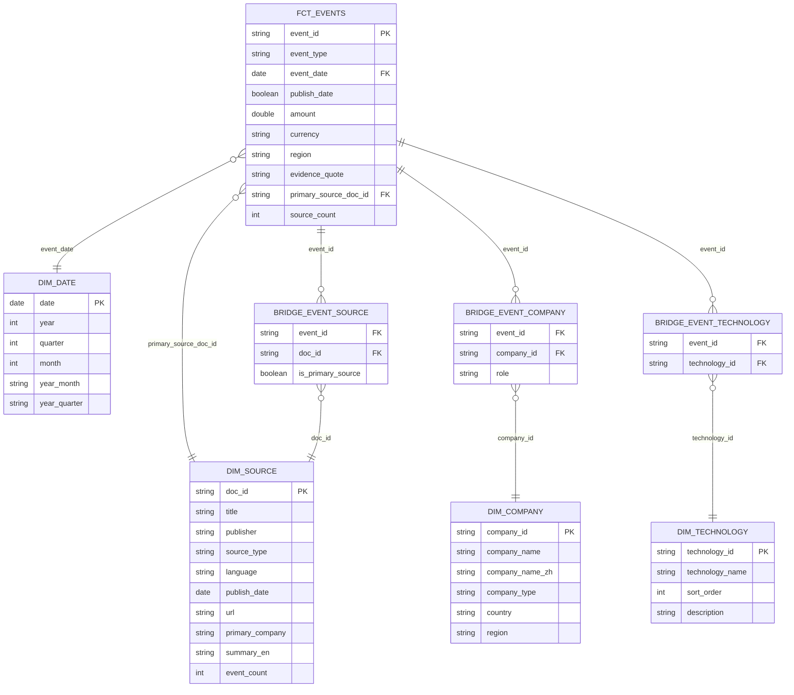

# Humanoid Robotics Market Intelligence Pipeline

A Databricks data engineering pipeline that turns public news, press releases, and filings about the humanoid robotics industry into structured, queryable, AI-ready market intelligence.

## Overview

Public announcements about humanoid robotics (funding rounds, partnerships, product launches, production plans, policy moves) arrive as unstructured text scattered across news sites, press releases, and filings. This pipeline ingests that text, uses AI to turn it into structured events, and organizes it into a Gold-layer star schema so both humans (BI/SQL) and AI (Genie, future RAG) can query it reliably.

It follows the medallion architecture on Databricks / Unity Catalog, in catalog `humanoid_robotics`:

```
Bronze (raw)  →  Silver (cleaned + AI-extracted)  →  Gold (star schema)
```

| Layer | What happens | Key tables |
|---|---|---|
| **Bronze** | Batch-ingest raw CSV seeds, raw document text, and a manifest describing each document. Full overwrite, no transformation. | `bronze.company_seed`, `bronze.company_other`, `bronze.company_alias`, `bronze.documents`, `bronze.manifest_pilot` |
| **Silver** | Clean text, translate, classify relevance, and run AI extraction into structured events; resolve company names against a master list. | `silver.documents_clean`, `silver.documents_relevance`, `silver.documents_extractions`, `silver.events_extracted`, `silver.event_companies`, `silver.company` |
| **Gold** | Star schema: one fact table of de-duplicated events, dimensions, and bridge tables for the many-to-many relationships. | `gold.fct_events`, `gold.dim_date`, `gold.dim_source`, `gold.dim_company`, `gold.dim_technology`, `gold.bridge_event_company`, `gold.bridge_event_technology`, `gold.bridge_event_source` |

## What makes this project different: AI applied at two levels

Most DE pipelines either skip AI entirely or only use it as a chatbot layer on top of finished tables. This project treats AI as a first-class citizen on **both** sides of the pipeline — and the job of the DE layer is to make that connection work.

### 1. AI *in* Data — using AI to process data (implemented, Silver layer)

Four Databricks SQL AI functions do the heavy lifting of turning free text into structured rows:

- **`ai_translate`** — translates non-English (`zh`) titles, publishers, and body text to English before anything downstream touches them (`scripts/silver/03_silver_documents.ipynb`).
- **`ai_classify`** — classifies each cleaned article as `about_humanoid_robots` / `not_about_humanoid_robots`, so only relevant documents reach the expensive extraction step (`scripts/silver/04_silver_doc_relevance.dbquery.ipynb`).
- **`ai_query`** (the core step) — runs `databricks-gpt-oss-120b` against each relevant document with a strict JSON schema (`responseFormat`), extracting 0–many events per article: type, status, date, companies and their role, technology areas, amount/currency, region, and a verbatim evidence quote (`scripts/silver/05_silver_document_extraction.dbquery.ipynb`). The extraction is idempotent — already-extracted documents are skipped.
- **`from_json`** — parses the AI's structured JSON output back into typed columns feeding `silver.document_summaries` and `silver.events_extracted` (`scripts/silver/06_silver_extraction_parse.dbquery.ipynb`).

### 2. AI *on* Data — using AI to answer questions with data (in progress, Gold layer)

The Gold star schema exists so AI can query it accurately, not just so humans can:

- **Column & table metadata** (this change) — every Gold table and column now has a `COMMENT`, so Catalog Explorer, Genie, and any LLM reading the schema know exactly what each field means and which enum values are valid.
- **Unity Catalog Metric Views** (this change) — `gold.mv_event_metrics` defines pre-aggregated, semantically unambiguous measures (event count, funding amount by currency, etc.) over `fct_events`, so Genie/Text-to-SQL answers business questions with the *right* aggregation instead of guessing a `GROUP BY`.
- **Genie Text-to-SQL** (next) — point Genie at the Gold schema + metric views so business users can ask natural-language questions directly.
- **Self-built RAG / vector search** (planned) — embed `evidence_quote`/`summary_en` text for semantic search over events, complementing the structured Text-to-SQL path.

The throughline: **DE's role in an AI-native stack isn't just "move data" — it's making sure AI can use that data to answer questions *correctly*.** Clean, well-described, semantically consistent Gold tables are what make the AI-on-data half possible at all.

## Star Schema (Gold Layer)



**Fact**: `fct_events` — one row per de-duplicated event. **Dimensions**: `dim_date`, `dim_source`, `dim_company`, `dim_technology`. **Bridges**: because one event can involve several companies (with different roles), relate to several technology areas, and be reported by several documents, those relationships are modeled as many-to-many bridge tables rather than flattened onto the fact row.

PK/FK constraints are declared in SQL (`scripts/gold/99_gold_constraints.dbquery.ipynb`) — informational rather than enforced, but visible in Catalog Explorer and used by Genie to understand how the tables relate.

## Data quality

`scripts/gold/09_gold_bridge_table_quality_checks.ipynb` checks the invariants the star schema is supposed to hold: uniqueness of bridge-table keys, referential integrity against `fct_events`/dimensions, source coverage, and a business rule that every `funding` event must have at least one company with role `target` or `issuer`.

## Repository structure

```
scripts/
├── bronze/   raw ingestion (company seeds, documents, manifest)
├── silver/   cleaning, translation, relevance classification, AI extraction, company resolution
└── gold/     star schema (fact, dimensions, bridges) + constraints + quality checks
datasets/
└── review/   manual-review exports
```

## Roadmap / known limitations

This is the first complete version of the pipeline. Shipped as-is rather than delayed for the items below, which are the known next steps:

- **Event de-duplication is a placeholder.** `silver/11_silver_event_dedup.dbquery.ipynb` currently maps each extracted event 1:1 to itself (`fct_events.source_count` is always `1`); real cross-document dedup (same event reported by multiple sources) is planned.
- **`fct_events.publish_date` is a boolean, not a date.** It flags whether `event_date` was inferred from the source document's publish date rather than stated explicitly in the text — it is *not* the document's publish date (that's `dim_source.publish_date`). The name is confusing and will be revisited; documented accurately in the column comment for now.
- **No CI/CD or Databricks Asset Bundle yet.** Deployment today is manual notebook execution in the workspace.
- **No incremental/streaming ingestion.** Bronze layer does full-table overwrite on every run.
- **dbt-based testing/lineage/docs** — planned, not yet implemented.
- **Genie Text-to-SQL + a self-built RAG/vector-search layer** — planned next, building on the metric views and column comments added in this change.

**Status: v0.1** — first end-to-end Bronze→Silver→Gold pipeline with AI-based event extraction, a documented star schema, and metric views for AI/BI consumption.
